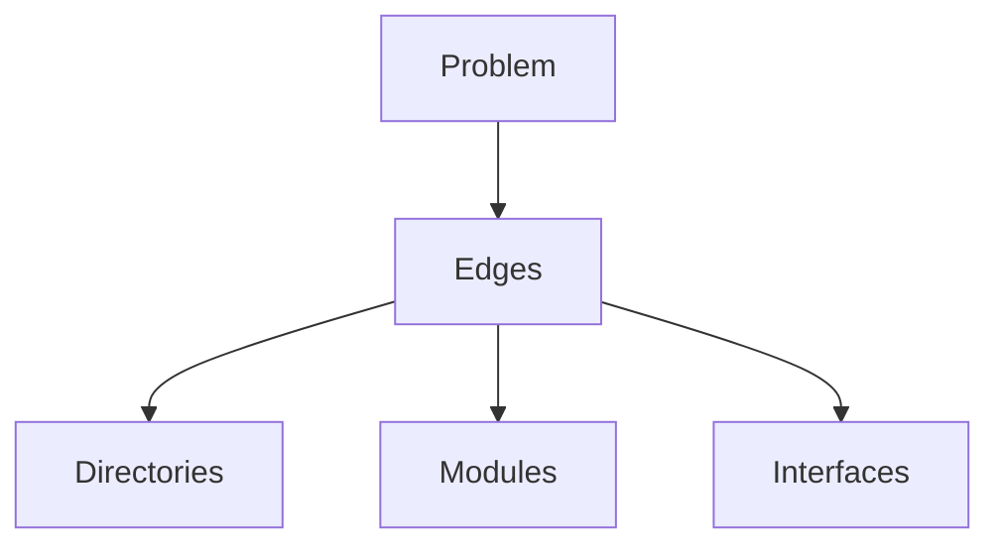

+++
title = "Draw the edges first"
date = "2026-11-03"
summary = "Architecture is not picking a framework. Draw what sits inside and what stays out, then the code has a place to land."
+++

Architecture is often told as a choice of language, framework, or middleware. Those come later. The first question is: which parts sit on this line, how they talk, and where a failure is cut off.

I draw on paper first. Boxes are duties. Arrows are dependencies. If one sheet cannot hold the picture, the code will not hold it either. Once the edges are clear, directories, modules, and interfaces can follow.

Rust Design Patterns and Best Practices is written in that order: name the layer the problem belongs to, then put the implementation next to it. The DAG is the same. The links matter more than the definition.

When the system has to change, change the drawing first. If the drawing still stands, the code is worth touching.
